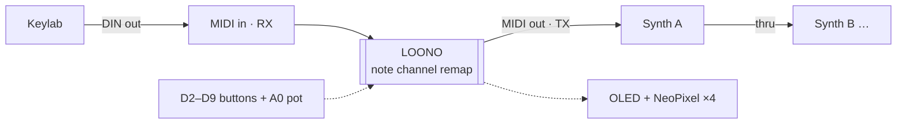

# Loono — board & sequencer spec

Planning reference for the pin map and panel behavior. This is the agreed basis for the firmware; update it here first if any of it changes.

## Signal path

Keylab notes enter on the opto-isolated MIDI in. Loono rewrites only note on/off to the active channel; everything else (CC, pitch bend, clock) passes through untouched and continues down the DIN chain to the synths.

Remapping happens per message, using whichever channel is active right then — so holding a key while switching channels sends that note's note-off on the new channel instead of the one it started on, letting the held note sustain independently on the channel you left. This quirk is kept deliberately; to stop it leaving a stuck note behind, switching *into* a channel still in standard mode sends an All Notes Off on it first, so anything stuck there from an earlier switch clears automatically instead of needing that same key pressed and released again. Switching into a sequencer-mode channel skips this, so it never cuts a note the lane is legitimately sustaining through a tie.

## Pin map

| Pin | Function | Notes |
|---|---|---|
| `D2`–`D9` | Panel buttons | Function depends on mode — see Button map below |
| `A0` | Tempo pot | 60–160 BPM, live while playing |
| `RX` / `D0` | MIDI in | Opto-isolated DIN in from the Keylab, 31250 baud |
| `TX` / `D1` | MIDI out | DIN out, daisy-chains to the synths |
| `SDA` / `SCL` | OLED | 128×64 SSD1306, I2C — shows channel, BPM, mode, and note names while editing |
| `D11` | NeoPixel ×4 | One LED per channel, mirrors active/mode state |

| LED state | Appearance |
|---|---|
| Active channel | Solid green |
| Inactive, standard | Off |
| Inactive, sequencer | *TBD — see open questions* |

## Button map by mode

Physical layout: `D2`–`D5` are the top row, `D6`–`D9` the bottom row. Three modes, edit reachable only from sequencer: **standard → sequencer → edit**.

### Standard

Active channel has no lane; Keylab notes pass straight through on its MIDI channel.

| D2 | D3 | D4 | D5 |
|---|---|---|---|
| Select ch 1 | Select ch 2 | Select ch 3 | Select ch 4 |

| D6 | D7 | D8 | D9 |
|---|---|---|---|
| — | — | — | — |

Pressing the already-active channel button toggles it into sequencer mode instead of selecting it.

### Sequencer (not editing)

Channel owns a 16-step lane that joins the shared clock; row 1 still picks the active channel.

| D2 | D3 | D4 | D5 |
|---|---|---|---|
| Select ch 1 | Select ch 2 | Select ch 3 | Select ch 4 |

| D6 | D7 | D8 | D9 |
|---|---|---|---|
| Play / Pause | Edit (arm) | — | — |

Play/Pause starts or stops one shared 16-step clock for every sequencer-mode channel at once (never per-channel) — step 1 fires for all of them together, then step 2, and so on. Each step is a **chord** (one or more notes), a **rest** (silence), or a **tie** (holds whatever the last chord was).

### Edit (sub-mode of sequencer)

Row 1 switches to step editing; row 2 keeps only exit and the clear actions. Entering edit always stops the clock and resets the cursor to step 1.

| D2 | D3 | D4 | D5 |
|---|---|---|---|
| Prev step | Next step | Skip | Tie |

| D6 | D7 | D8 | D9 |
|---|---|---|---|
| — | Exit edit | Clear step | Clear all |

Hold up to 4 Keylab keys at once — their note names show on the OLED while held — and release them all to commit that chord to the cursor and advance one step (wraps 16→1). **Skip** writes a rest and advances; **Tie** marks sustain-previous and advances; **Prev/Next** move the cursor without writing; **Clear step** rests the current step in place; **Clear all** rests the whole 16-step lane.

## Open questions

- **Play restart vs. resume** — does pressing Play always restart the clock at step 1, or resume from wherever it was paused?
- **Velocity** — does a recorded chord keep the velocity it was played at, or get a fixed value?
- **Tie on step 1** — a tie with nothing before it has nothing to sustain, should it just behave like a rest?
- **Switching a channel to standard mid-playback** — does its sounding note cut immediately or ring out?
- **LED for an inactive sequencer-mode channel** — solid, dim, or blinking in time with the shared clock?
