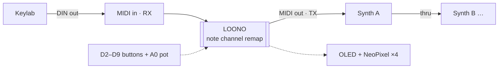

# Loono — board & sequencer spec

Planning reference for the pin map and panel behavior. This is the agreed basis for the firmware; update it here first if any of it changes.

## Signal path

Keylab notes enter on the opto-isolated MIDI in. Loono rewrites only note on/off to the active channel; everything else (CC, pitch bend, clock) passes through untouched and continues down the DIN chain to the synths.

Remapping happens per message, using whichever channel is active right then — so holding a key while switching channels sends that note's note-off on the new channel instead of the one it started on, letting the held note sustain independently on the channel you left. This quirk is kept deliberately; to stop it leaving a stuck note behind, switching *into* a channel still in standard mode sends an All Notes Off on it first, so anything stuck there from an earlier switch clears automatically instead of needing that same key pressed and released again. Switching into a sequencer-mode channel skips this, so it never cuts a note the lane is legitimately sustaining through a tie.

## Pin map

| Pin | Function | Notes |
|---|---|---|
| `D2`–`D9` | Panel buttons | Function depends on mode — see Button map below |
| `A0` | Tempo pot | 60–160 BPM, live while playing |
| `RX` / `D0` | MIDI in | Opto-isolated DIN in from the Keylab, 31250 baud |
| `TX` / `D1` | MIDI out | DIN out, daisy-chains to the synths |
| `SDA` / `SCL` | OLED | 128×64 SSD1306, I2C — shows BPM, channel or transport + step (`Loono 01` / `Play. 05`), and note names while editing |
| `D11` | NeoPixel ×4 | One LED per channel, mirrors active/mode state |

| LED state | Appearance |
|---|---|
| Active, standard | Green |
| Active, sequencer | Violet |
| Inactive, sequencer | Dim violet |
| Inactive, standard | Off |

Colour carries the mode, so the OLED doesn't repeat it. The big line reads `Loono 01` in standard mode (device + active channel), and `Play. 05` / `Pause 05` / `Edit 03` once the channel has a lane, with held note names beneath while a chord is being built. BPM sits top-right throughout.

## Button map by mode

Physical layout: `D2`–`D5` are the top row, `D6`–`D9` the bottom row. Three modes, edit reachable only from sequencer: **standard → sequencer → edit**.

### Standard

Active channel has no lane; Keylab notes pass straight through on its MIDI channel.

| D2 | D3 | D4 | D5 |
|---|---|---|---|
| Select ch 1 | Select ch 2 | Select ch 3 | Select ch 4 |

| D6 | D7 | D8 | D9 |
|---|---|---|---|
| Play / Pause | — | — | — |

Pressing the already-active channel button toggles it into sequencer mode instead of selecting it. Play/Pause is global — it stays live in every mode so lanes can be started and stopped without leaving the channel you're playing on.

### Sequencer (not editing)

Channel owns a 16-step lane that joins the shared clock; row 1 still picks the active channel. A channel is either sequenced or played live, never both — while in sequencer mode its notes come only from its lane, and Keylab keys do not pass through on it. The exception is edit mode, where keys sound so you can hear what you're recording.

| D2 | D3 | D4 | D5 |
|---|---|---|---|
| Select ch 1 | Select ch 2 | Select ch 3 | Select ch 4 |

| D6 | D7 | D8 | D9 |
|---|---|---|---|
| Play / Pause | Edit (arm) | — | — |

Play/Pause starts or stops one shared 16-step clock for every sequencer-mode channel at once (never per-channel) — step 1 fires for all of them together, then step 2, and so on. Pause holds position; the next Play resumes from that step rather than restarting at 1. Each step is a **chord** (up to 4 notes), a **rest** (silence), or a **tie** (holds whatever the last chord was).

A step is one 16th note: `60000 / BPM / 4` ms — 250 ms at 60 BPM down to 94 ms at 160 BPM. Chord gate length is tempo-dependent, since one fixed ratio doesn't suit both ends of the range:

| Tempo | Gate | Why |
|---|---|---|
| Under 120 BPM | 70% of the step | Long steps get space between notes instead of smearing into each other |
| 120 BPM and up | 90% of the step | Short steps stay audible, with just enough gap for repeated chords to retrigger |

Both percentages are tuning constants — adjust by ear on the real synths.

Each recorded note keeps the velocity it was played at. A tie on step 1 has nothing before it to sustain, so it plays as a rest. Toggling a channel back to standard cuts any note its lane is sounding immediately, so nothing is left stranded without a lane to end it.

### Edit (sub-mode of sequencer)

Row 1 switches to step editing; row 2 keeps only exit and the clear actions. Entering edit always stops the clock and resets the cursor to step 1.

| D2 | D3 | D4 | D5 |
|---|---|---|---|
| Prev step | Next step | Skip | Tie |

| D6 | D7 | D8 | D9 |
|---|---|---|---|
| — | Exit edit | Clear step | Clear all |

Hold Keylab keys and release them all to commit that chord to the cursor and advance one step (wraps 16→1). The first 4 notes pressed are recorded; any held beyond that sound but are not stored. **Skip** writes a rest and advances; **Tie** marks sustain-previous and advances; **Prev/Next** move the cursor without writing; **Clear step** rests the current step in place; **Clear all** rests the whole 16-step lane. Either clear shows a one-second `Step cleared` / `All cleared` confirmation.

Editing is audible, which is what makes the lane reviewable:

- Keys you play sound on the channel as you press them, so you hear what you're about to record.
- **Arriving** on a step — by arrow, or by the auto-advance after a commit, skip or tie — sounds whatever that step already holds. So the arrows walk and audition a prepared lane; stop on a step you don't like and play new keys to replace it.
- The OLED shows the current step's contents: its note names, `Tie`, or `Skip`. While keys are held it shows the chord being built instead.

## Timing constraints

The previous build was abandoned over MIDI latency, skipped LED beats, and notes landing off-grid. Two rules exist to prevent a repeat:

- **MIDI first, always.** Read and forward MIDI before any display or LED work in the loop, and never block it — no `delay()` outside `setup()`.
- **Never redraw the full OLED on the step path.** A full 128×64 SSD1306 frame over I2C costs roughly 25 ms; a step at 160 BPM is 94 ms. Redraw only the small rect that changed, and throttle updates independently of the step clock.

## Startup state

A two-second `Loono` splash, centred on the screen, then: channel 1 active, all four channels in standard mode, clock stopped — straight passthrough on boot, with sequencing opted into deliberately. Lanes are session-only: patterns are not saved and are lost at power-off.
