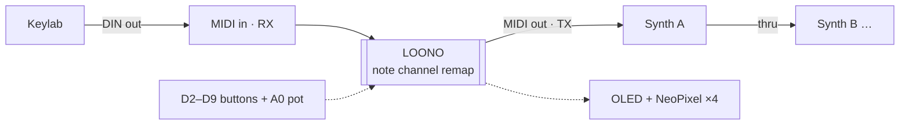

# Loono — board & sequencer spec

Planning reference for the pin map, panel controls, and sequencer behavior. This is the agreed basis for the firmware; update it here first if any of it changes.

## Signal path

Keylab notes enter on the opto-isolated MIDI in. Loono rewrites only note on/off to the active channel; everything else (CC, pitch bend, clock) passes through untouched and continues down the DIN chain to the synths.

## Pin map

| Pin | Function | Notes |
|---|---|---|
| `D2`–`D5` | Channel buttons 1–4 | Select active channel; second press on the active one mutes/unmutes its lane |
| `D6` | Play / Pause | Starts or stops the shared clock for all 4 lanes |
| `D7` | Edit | Arms step recording on the active channel |
| `D8` | Skip | Edit mode only — writes a rest, advances |
| `D9` | Tie | Edit mode only — sustains previous step, advances |
| `A0` | Tempo pot | 60–160 BPM, live while playing |
| `RX` / `D0` | MIDI in | Opto-isolated DIN in from the Keylab, 31250 baud |
| `TX` / `D1` | MIDI out | DIN out, daisy-chains to the synths |
| `SDA` / `SCL` | OLED | 128×64 SSD1306, I2C |
| `D11` | NeoPixel ×4 | One LED per channel, mirrors active/muted state |

## Channel LED states

| State | LED |
|---|---|
| Active, enabled | Solid green |
| Active, muted | Solid amber |
| Inactive (either state) | Off |

## Sequencer model

Each of the 4 channels owns an independent 16-step lane. Every step is exactly one of three types:

- **chord** — one or more notes captured together, triggered at that step
- **rest** — nothing plays
- **tie** — no new note; whatever is sounding from an earlier step keeps ringing through it

Example lane:

| Step | 1 | 2 | 3 | 4 | 5 | 6–16 |
|---|---|---|---|---|---|---|
| Content | `C4+E4` | rest | `G4` | tie | tie | rest |

Step 3's `G4` sustains through the two tied steps that follow it before the lane goes quiet.

## Recording (edit mode)

Edit arms the active channel only; the other three keep playing or resting as already programmed.

1. Press **Edit** — the active channel's cursor is armed at its current step, shown on the OLED.
2. Hold one or more keys on the Keylab. Any note pressed while at least one key is still down joins the same chord.
3. Release the last held key — the chord commits to the current step and the cursor advances one step (wraps 16→1).
4. **Skip** writes a rest at the cursor and advances, without touching the keyboard.
5. **Tie** marks the cursor as sustain-previous and advances.

## Playback

One shared 16-step clock drives all four lanes at the pot's tempo. On each step, an enabled lane plays its chord, holds through any following ties, and goes silent on a rest. A muted lane is skipped entirely. **Play / Pause** starts and stops the clock for every lane at once — there is no per-channel transport.

## Open questions

- **Chord size cap** — how many simultaneous notes should a step be allowed to hold, is there a polyphony limit worth enforcing on the record side?
- **Play restart vs. resume** — does pressing Play always restart the clock at step 1, or resume from wherever it was paused?
- **Edit while playing** — can Edit be armed while the clock is running (punch-in over live playback), or only while stopped?
- **Muting a sounding note** — if a channel is muted mid-note, does the note cut immediately or ring out?
- **Velocity** — does a recorded chord keep the velocity it was played at, or get a fixed value?
- **Tie on step 1** — a tie with nothing before it has nothing to sustain, should it just behave like a rest?
