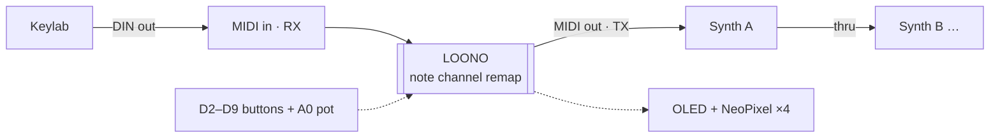

# Loono — board & sequencer spec

Planning reference for the pin map, panel controls, and sequencer behavior. This is the agreed basis for the firmware; update it here first if any of it changes.

## Signal path

Keylab notes enter on the opto-isolated MIDI in. Loono rewrites only note on/off to the active channel; everything else (CC, pitch bend, clock) passes through untouched and continues down the DIN chain to the synths.

## Pin map

| Pin | Function | Notes |
|---|---|---|
| `D2`–`D5` | Channel buttons 1–4 (row 1) | Function depends on mode — see [Button map by mode](#button-map-by-mode) |
| `D6`–`D9` | Transport / edit buttons (row 2) | Function depends on mode — see [Button map by mode](#button-map-by-mode) |
| `A0` | Tempo pot | 60–160 BPM, live while playing |
| `RX` / `D0` | MIDI in | Opto-isolated DIN in from the Keylab, 31250 baud |
| `TX` / `D1` | MIDI out | DIN out, daisy-chains to the synths |
| `SDA` / `SCL` | OLED | 128×64 SSD1306, I2C |
| `D11` | NeoPixel ×4 | One LED per channel, mirrors active/mode state |

## Button map by mode

Physical layout: `D2`–`D5` are the top row, `D6`–`D9` the bottom row. There are three modes, and edit is a sub-mode reachable only from sequencer: **standard → sequencer → edit**.

### Standard mode

The active channel has no lane; row 2 has nothing to do.

| D2 | D3 | D4 | D5 |
|---|---|---|---|
| Select ch 1 | Select ch 2 | Select ch 3 | Select ch 4 |

| D6 | D7 | D8 | D9 |
|---|---|---|---|
| — | — | — | — |

Pressing the already-active channel button toggles it into sequencer mode instead of selecting it — see [Channel modes](#channel-modes).

### Sequencer mode (active channel, not editing)

Row 1 still selects/toggles channels; row 2 gains transport now that this channel has a lane.

| D2 | D3 | D4 | D5 |
|---|---|---|---|
| Select ch 1 | Select ch 2 | Select ch 3 | Select ch 4 |

| D6 | D7 | D8 | D9 |
|---|---|---|---|
| Play / Pause | Edit (arm) | — | — |

### Edit mode (sub-mode of sequencer)

Row 1 switches entirely to step editing; row 2 keeps only exit and the clear actions.

| D2 | D3 | D4 | D5 |
|---|---|---|---|
| Prev step | Next step | Skip | Tie |

| D6 | D7 | D8 | D9 |
|---|---|---|---|
| — | Exit edit | Clear step | Clear all |

The shared clock is already stopped the moment Edit was pressed — see [Recording](#recording-edit-mode).

## Channel modes

Each channel is independently in one of two modes — this is per channel, not tied to which one is currently active:

- **Standard** — no lane. Notes played on the Keylab while this channel is active pass straight through on its MIDI channel, as today. Row 2 (`D6`–`D9`) has no function.
- **Sequencer** — the channel's 16-step lane exists and joins the shared clock. Its own play/stopped state follows the global transport (see Playback below), not a per-channel one. Row 2 gains Play/Pause and Edit; Edit is only reachable from here.

Active channel selection and per-channel mode are independent: several channels can be in sequencer mode at once, and only one is "active" (the live-note / edit target) at a time. For example: channel 1's lane plays on its own while channel 2 stays in standard mode and you play live over it, or both channel 1 and channel 2 can be in sequencer mode and play their lanes together in sync.

| State | LED |
|---|---|
| Active | Solid green |
| Inactive, standard | Off |
| Inactive, sequencer | *TBD — see open questions* |

## Sequencer model

Each of the 4 channels owns an independent 16-step lane. Every step is exactly one of three types:

- **chord** — one or more notes captured together, triggered at that step
- **rest** — nothing plays
- **tie** — no new note; whatever is sounding from an earlier step keeps ringing through it

Example lane:

| Step | 1 | 2 | 3 | 4 | 5 | 6–16 |
|---|---|---|---|---|---|---|
| Content | `C4+E4` | rest | `G4` | tie | tie | rest |

Step 3's `G4` sustains through the two tied steps that follow it before the lane goes quiet.

## Recording (edit mode)

Edit arms the active channel only; the other three keep playing or resting as already programmed.

1. With the active channel already in sequencer mode, press **Edit** (`D7`) — this stops the shared clock if it was running, and arms the cursor at step 1, always, regardless of where playback last was. `D2`–`D5` switch from channel select to step editing for as long as edit stays armed.
2. Hold one or more keys on the Keylab. Any note pressed while at least one key is still down joins the same chord.
3. Release the last held key — the chord commits to the current step and the cursor advances one step (wraps 16→1).
4. **Skip** (`D4`) writes a rest at the cursor and advances, without touching the keyboard.
5. **Tie** (`D5`) marks the cursor as sustain-previous and advances.
6. **Prev** (`D2`) / **Next** (`D3`) move the cursor back or forward without writing anything, to review or retarget a step.
7. **Clear step** (`D8`) sets the step at the cursor to rest; the cursor does not move. **Clear all** (`D9`) wipes all 16 steps on this channel to rest.
8. **Exit edit** (`D7`) disarms edit mode and returns `D2`–`D5` to channel select.

## Playback

One shared 16-step clock drives every channel in sequencer mode — step 1 fires for all of them together, then step 2, and so on, never independently. On each step, a sequencer-mode channel plays its chord, holds through any following ties, and goes silent on a rest. A channel left in standard mode takes no part in playback. **Play / Pause** starts and stops the shared clock for every sequencer-mode channel at once — there is no per-channel transport.

## Open questions

- **Chord size cap** — how many simultaneous notes should a step be allowed to hold, is there a polyphony limit worth enforcing on the record side?
- **Play restart vs. resume** — does pressing Play always restart the clock at step 1, or resume from wherever it was paused?
- **Velocity** — does a recorded chord keep the velocity it was played at, or get a fixed value?
- **Tie on step 1** — a tie with nothing before it has nothing to sustain, should it just behave like a rest?
- **Switching a channel to standard mid-playback** — does its sounding note cut immediately or ring out?
- **LED for an inactive sequencer-mode channel** — solid, dim, or blinking in time with the shared clock?
